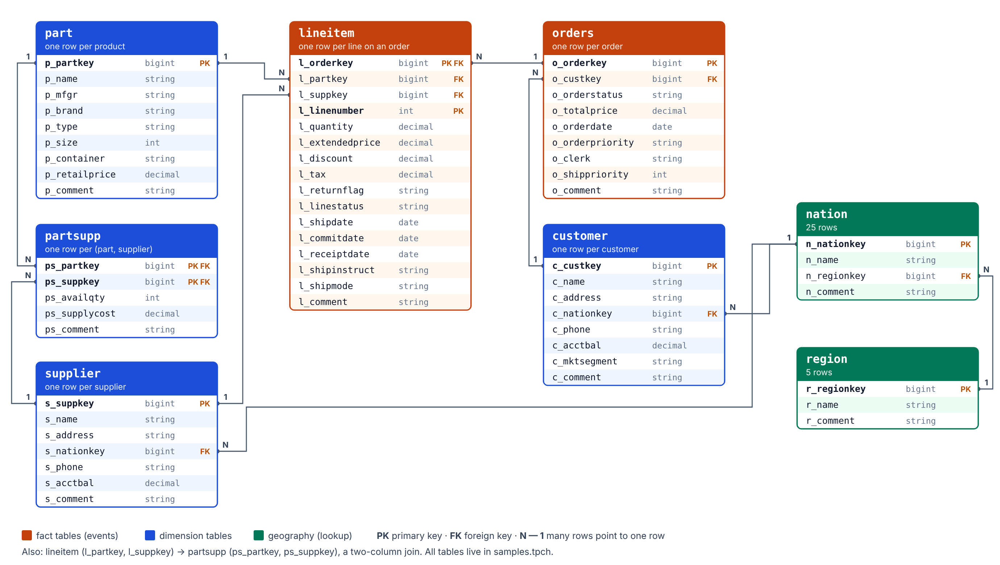

# SQL tutorial on Databricks

DSC 592 · Data Engineering · Fall 2026 · Lecture 4 (Lab 1C) and Week 2

This tutorial walks through the core SQL commands using the sample data that every Databricks workspace has:
the `samples` catalog. Nothing to download, nothing to install.

**Contents**

1. [The data: `samples.tpch` and `samples.nyctaxi`](#1-the-data-samplestpch-and-samplesnyctaxi)
2. [Exploring what is there: SHOW, DESCRIBE, USE](#2-exploring-what-is-there-show-describe-use)
3. [Two tiny practice tables](#3-two-tiny-practice-tables)
4. [SELECT and LIMIT](#4-select-and-limit)
5. [COUNT](#5-count)
6. [WHERE](#6-where)
7. [LIKE and ILIKE](#7-like-and-ilike)
8. [DISTINCT](#8-distinct)
9. [Exercises A](#9-exercises-a)
10. [ORDER BY](#10-order-by)
11. [Aggregate functions](#11-aggregate-functions)
12. [GROUP BY, aliases and HAVING](#12-group-by-aliases-and-having)
13. [String functions](#13-string-functions)
14. [NULL](#14-null)
15. [Exercises B](#15-exercises-b)
16. [Clause order](#16-clause-order)
17. [JOIN basics with the tiny tables](#17-join-basics-with-the-tiny-tables)
18. [JOINs on TPC-H](#18-joins-on-tpc-h)
19. [Joining on more than one column](#19-joining-on-more-than-one-column)
20. [One-to-one, many-to-one, many-to-many](#20-one-to-one-many-to-one-many-to-many)
21. [Exercises C](#21-exercises-c)
22. [Coming from MySQL: what is different](#22-coming-from-mysql-what-is-different)
23. [Quick reference](#23-quick-reference)

---


## 1. The data: `samples.tpch` and `samples.nyctaxi`

**`samples.tpch`** is a made-up wholesale supplier: customers place orders, each order has line items, each line item
is a part bought from a supplier. 



| Table | One row per | Key columns |
| --- | --- | --- |
| `region` | world region (5 rows) | `r_regionkey`, `r_name` |
| `nation` | country (25 rows) | `n_nationkey`, `n_name`, `n_regionkey` → region |
| `customer` | customer | `c_custkey`, `c_name`, `c_nationkey` → nation, `c_mktsegment`, `c_acctbal` |
| `orders` | order | `o_orderkey`, `o_custkey` → customer, `o_orderstatus`, `o_totalprice`, `o_orderdate` |
| `lineitem` | line on an order | `l_orderkey` → orders, `l_partkey` → part, `l_suppkey` → supplier, `l_quantity`, `l_extendedprice`, `l_discount`, `l_shipmode` |
| `part` | product | `p_partkey`, `p_name`, `p_mfgr`, `p_brand`, `p_type`, `p_size`, `p_container`, `p_retailprice` |
| `supplier` | supplier | `s_suppkey`, `s_name`, `s_nationkey` → nation |
| `partsupp` | (part, supplier) pair | `ps_partkey`, `ps_suppkey`, `ps_availqty`, `ps_supplycost` |

```text
region ─< nation ─< customer ─< orders ─< lineitem >─ part
                 └─< supplier ───────────────┘
```

`─<` means "one to many": one region has many nations, one customer has many orders, and so on.
Every column name starts with its table's letter (`c_` for customer, `o_` for orders), which makes joins easy to read.

**`samples.nyctaxi.trips`** is one table of New York taxi trips (early 2016): `tpep_pickup_datetime`,
`tpep_dropoff_datetime`, `trip_distance`, `fare_amount`, `pickup_zip`, `dropoff_zip`. We use it for Demo 1-style
time-based questions.

The `samples` catalog is **read-only**: you can query it, but not change it.

---

## 2. Exploring what is there: SHOW, DESCRIBE, USE

Tables in Databricks have a three-level name: **catalog.schema.table**, for example `samples.tpch.customer`.

```sql
SHOW CATALOGS;                        -- samples, workspace, system, ...
SHOW SCHEMAS IN samples;              -- nyctaxi, tpch, ...
SHOW TABLES IN samples.tpch;          -- customer, lineitem, nation, orders, ...
DESCRIBE TABLE samples.tpch.customer; -- column names and types
```

`DESCRIBE TABLE EXTENDED samples.tpch.customer;` adds details such as the owner, the storage format (Delta) and
the location. You can also browse all of this by clicking in **Catalog Explorer**.

**Shortcut with `USE`.** If you will query one schema many times, set it as the default, then use short names:

```sql
USE CATALOG samples;
USE SCHEMA tpch;
SELECT * FROM nation LIMIT 5;   -- means samples.tpch.nation
```

This tutorial always writes the full three-level name, so every query works no matter what you ran before.

---

## 3. Two tiny practice tables

To *see* what joins and NULLs do, it helps to have tables small enough to check by eye. Create these once in your
own catalog (`workspace`, schema `default`). Run all four statements together:

```sql
CREATE OR REPLACE TABLE workspace.default.author (author_id INT, author_name STRING);
INSERT INTO workspace.default.author VALUES
  (1, 'Joe'), (2, 'Sally'), (3, 'Sue'), (4, 'Tom'), (5, 'Harry');

CREATE OR REPLACE TABLE workspace.default.book (book_id INT, author_id INT, title STRING);
INSERT INTO workspace.default.book VALUES
  (1, 2, 'Cats'), (2, 1, 'Trees'), (3, 4, 'Bushes'), (4, 2, 'Dogs'), (5, 3, 'Tomatoes'), (6, NULL, 'Nothing');
```

```text
author                     book
author_id  author_name     book_id  author_id  title
1          Joe             1        2          Cats
2          Sally           2        1          Trees
3          Sue             3        4          Bushes
4          Tom             4        2          Dogs
5          Harry           5        3          Tomatoes
                           6        NULL       Nothing
```

Notice: Harry (5) wrote no book, and the book "Nothing" has no author.

---

## 4. SELECT and LIMIT

```sql
-- All columns of a small table
SELECT *
FROM samples.tpch.nation;

-- Only some columns
SELECT n_name, n_regionkey
FROM samples.tpch.nation;

-- First 7 rows of a big table
SELECT *
FROM samples.tpch.part
LIMIT 7;
```

- `SELECT *` means "every column". Fine for a 25-row table like `nation`; on a big table, **always add `LIMIT`**.
- SQL keywords are not case-sensitive (`select` = `SELECT`). Writing them in capitals is a common style.
- Spread a query over several lines; the database ignores line breaks. End a statement with `;` when you run several.
- `--` starts a comment.

`LIMIT` without `ORDER BY` gives you *some* rows, not necessarily the "first" ones. If you need a specific order, sort
first ([Section 10](#10-order-by)).

---

## 5. COUNT

Check how big a table is **before** you pull rows from it.

```sql
SELECT COUNT(*) FROM samples.tpch.region;     -- 5
SELECT COUNT(*) FROM samples.tpch.nation;     -- 25
SELECT COUNT(*) FROM samples.tpch.customer;
SELECT COUNT(*) FROM samples.tpch.lineitem;   -- many millions
```

| Form | Counts |
| --- | --- |
| `COUNT(*)` | rows |
| `COUNT(col)` | rows where `col` is **not NULL** |
| `COUNT(DISTINCT col)` | different non-NULL values of `col` |

```sql
SELECT COUNT(*)          AS all_rows,         -- 6
       COUNT(author_id)  AS with_author,      -- 5  (the NULL is skipped)
       COUNT(DISTINCT author_id) AS authors   -- 4  (Sally appears twice)
FROM workspace.default.book;
```

`AS name` gives the result column a readable name (more in [Section 12](#12-group-by-aliases-and-having)).

---

## 6. WHERE

`WHERE` keeps only the rows that meet a condition.

```sql
-- Equal: one = sign. Text goes in single quotes.
SELECT *
FROM samples.tpch.nation
WHERE n_name = 'JAPAN';

-- Comparisons: <  >  <=  >=  <> (not equal)
SELECT *
FROM samples.tpch.nation
WHERE n_nationkey < 5;

-- AND / OR
SELECT *
FROM samples.tpch.nation
WHERE n_regionkey = 2 AND n_nationkey > 10;

-- IN: membership in a list
SELECT n_name, n_regionkey
FROM samples.tpch.nation
WHERE n_regionkey IN (0, 3);

-- BETWEEN: a range, both ends included
SELECT o_orderkey, o_orderdate, o_totalprice
FROM samples.tpch.orders
WHERE o_orderdate BETWEEN '1995-01-01' AND '1995-01-31'
LIMIT 10;
```

When you mix `AND` and `OR`, use parentheses: `WHERE (a = 1 OR a = 2) AND b > 0`. Without them, `AND` is applied
first, which is often not what you meant.

Text values are case-sensitive: `n_name = 'Japan'` finds nothing, because the data says `'JAPAN'`.

---

## 7. (Self-study) LIKE and ILIKE

`LIKE` matches text against a pattern with wildcards:

| Wildcard | Matches |
| --- | --- |
| `%` | any text, including none |
| `_` | exactly one character |

```sql
-- Part names that contain the word "chocolate"
SELECT p_partkey, p_name
FROM samples.tpch.part
WHERE p_name LIKE '%chocolate%'
LIMIT 10;

-- Part types that start with PROMO and end with BRASS
SELECT DISTINCT p_type
FROM samples.tpch.part
WHERE p_type LIKE 'PROMO%BRASS';

-- Nations whose name is exactly 4 letters
SELECT n_name
FROM samples.tpch.nation
WHERE n_name LIKE '____';
```

`LIKE` is **case-sensitive** in Databricks. Use `ILIKE` to ignore case:

```sql
SELECT n_name
FROM samples.tpch.nation
WHERE n_name ILIKE 'united%';     -- UNITED KINGDOM, UNITED STATES
```

**Why patterns matter for data engineers:** real data is messy. If one job title is typed "Sales Manager" and another
"Sale Manager", `= 'Sales Manager'` misses one, but `LIKE 'Sale%Manager%'` finds both. Cleaning that up is exactly
what the silver layer is for (Lecture 14).

---

## 8. DISTINCT

`DISTINCT` removes duplicate rows from the result.

```sql
-- The market segments customers belong to
SELECT DISTINCT c_mktsegment
FROM samples.tpch.customer;               -- 5 segments

-- With two columns: each unique *combination*
SELECT DISTINCT p_mfgr, p_brand
FROM samples.tpch.part;
```

To count them: `SELECT COUNT(DISTINCT c_mktsegment) FROM samples.tpch.customer;`

---

## 9. Exercises A

Use `samples.tpch`. Write each query, then open the solution to compare.

1. Find parts whose name contains `almond`. Show `p_partkey` and `p_name`.
2. Find all parts with `p_size` 50 and `p_container` `'JUMBO BOX'`.
3. How many customers are in the `AUTOMOBILE` or `BUILDING` segments? (One number.)
4. List the part types (`p_type`) that contain `POLISHED`, without repeats.
5. Which ship modes (`l_shipmode`) appear in `lineitem`? *Check: there are 7.*
6. How many different (`p_mfgr`, `p_brand`) combinations are there? *Check: 25.*

<details>
<summary>Solutions A</summary>

```sql
-- 1
SELECT p_partkey, p_name
FROM samples.tpch.part
WHERE p_name LIKE '%almond%';

-- 2
SELECT *
FROM samples.tpch.part
WHERE p_size = 50 AND p_container = 'JUMBO BOX';

-- 3
SELECT COUNT(*)
FROM samples.tpch.customer
WHERE c_mktsegment IN ('AUTOMOBILE', 'BUILDING');

-- 4
SELECT DISTINCT p_type
FROM samples.tpch.part
WHERE p_type LIKE '%POLISHED%';

-- 5
SELECT DISTINCT l_shipmode
FROM samples.tpch.lineitem;

-- 6
SELECT COUNT(*)
FROM (SELECT DISTINCT p_mfgr, p_brand FROM samples.tpch.part);
```

For 6, `COUNT(DISTINCT p_mfgr, p_brand)` also works in Databricks. The version above (a query inside `FROM`, called a
*subquery*) works in every database.

</details>

---

## 10. ORDER BY

```sql
-- Sort by one column (ascending is the default)
SELECT n_name, n_regionkey
FROM samples.tpch.nation
ORDER BY n_regionkey;

-- Sort by region, then by name within each region
SELECT n_name, n_regionkey
FROM samples.tpch.nation
ORDER BY n_regionkey, n_name;

-- Descending
SELECT n_name, n_regionkey
FROM samples.tpch.nation
ORDER BY n_regionkey DESC, n_name DESC;
```

In the first query, the names *within* a region come back in no guaranteed order. If the order matters, list every
column you want sorted. `ORDER BY a ASC, b DESC` is the same as `ORDER BY a, b DESC`.

Combine with `LIMIT` for "top N" questions:

```sql
-- The 5 most expensive orders
SELECT o_orderkey, o_custkey, o_totalprice
FROM samples.tpch.orders
ORDER BY o_totalprice DESC
LIMIT 5;
```

---

## 11. Aggregate functions

An aggregate function turns many rows into one value.

| Function | Returns |
| --- | --- |
| `COUNT(*)` | number of rows |
| `SUM(col)` | total |
| `AVG(col)` | mean |
| `MIN(col)`, `MAX(col)` | smallest, largest (also works on dates and text) |

```sql
SELECT COUNT(*)                     AS n_orders,
       ROUND(AVG(o_totalprice), 2)  AS avg_total,
       MIN(o_totalprice)            AS smallest,
       MAX(o_totalprice)            AS largest,
       MIN(o_orderdate)             AS first_order,
       MAX(o_orderdate)             AS last_order
FROM samples.tpch.orders;
```

`ROUND(x, 2)` rounds to 2 decimals. Profiling a table like this (how many rows, what range of values and dates) is
the first thing to do with any new data.

---

## 12. GROUP BY, aliases and HAVING

`GROUP BY` splits the rows into groups and runs the aggregate once per group.

```sql
-- Number of customers in each market segment
SELECT c_mktsegment, COUNT(*) AS n_customers
FROM samples.tpch.customer
GROUP BY c_mktsegment
ORDER BY n_customers DESC;

-- Average account balance per segment
SELECT c_mktsegment,
       ROUND(AVG(c_acctbal), 2) AS avg_balance,
       COUNT(*)                 AS n_customers
FROM samples.tpch.customer
GROUP BY c_mktsegment;

-- Number of nations in each region (5 each)
SELECT n_regionkey, COUNT(*) AS n_nations
FROM samples.tpch.nation
GROUP BY n_regionkey;
```

**Aliases.** `AS n_customers` names the result column. You can use the alias later in `ORDER BY`, as above.
Databricks also lets you use it in `GROUP BY`.

**The GROUP BY rule.** Every column in `SELECT` must either be in `GROUP BY` or be inside an aggregate function.

```sql
-- Error in Databricks: c_name is neither grouped nor aggregated
SELECT c_mktsegment, c_name, COUNT(*)
FROM samples.tpch.customer
GROUP BY c_mktsegment;
```

This makes sense: a segment has thousands of customers, so which `c_name` should it show? (MySQL quietly picks one;
Databricks refuses.) Databricks has a shortcut that groups by every non-aggregated column: `GROUP BY ALL`.

**HAVING** filters *groups*, after grouping. `WHERE` filters *rows*, before grouping.

```sql
-- Pickup ZIP codes with at least 1000 trips, busiest first
SELECT pickup_zip, COUNT(*) AS trips, ROUND(AVG(fare_amount), 2) AS avg_fare
FROM samples.nyctaxi.trips
WHERE fare_amount > 0              -- row filter
GROUP BY pickup_zip
HAVING COUNT(*) >= 1000            -- group filter
ORDER BY trips DESC;
```

You can group by an expression, too:

```sql
-- Taxi trips per hour of the day
SELECT hour(tpep_pickup_datetime) AS pickup_hour, COUNT(*) AS trips
FROM samples.nyctaxi.trips
GROUP BY pickup_hour
ORDER BY pickup_hour;

-- Orders per year
SELECT year(o_orderdate) AS order_year, COUNT(*) AS n_orders
FROM samples.tpch.orders
GROUP BY order_year
ORDER BY order_year;
```

---

## 13. String functions

| Function | Example | Result |
| --- | --- | --- |
| `length(s)` | `length('JAPAN')` | `5` |
| `upper(s)`, `lower(s)` | `lower('JAPAN')` | `japan` |
| `initcap(s)` | `initcap('UNITED STATES')` | `United States` |
| `substring(s, start, len)` | `substring('Brand#13', 7, 2)` | `13` |
| `concat(a, b, …)` or `a \|\| b` | `concat(n_name, ' (', n_nationkey, ')')` | `JAPAN (12)` |
| `trim(s)` | `trim('  hi ')` | `hi` |

```sql
SELECT n_name,
       initcap(n_name)   AS pretty_name,
       length(n_comment) AS comment_length
FROM samples.tpch.nation
ORDER BY comment_length DESC;
```

String functions are the everyday tools for cleaning text columns in the silver layer.

---

## 14. NULL

`NULL` means "missing" or "unknown". It is not zero and not an empty string.

```sql
-- Books with no author
SELECT *
FROM workspace.default.book
WHERE author_id IS NULL;        -- Nothing

-- Books that have an author
SELECT *
FROM workspace.default.book
WHERE author_id IS NOT NULL;
```

**`= NULL` never matches anything**, not even NULL. Always use `IS NULL` / `IS NOT NULL`.

Other NULL rules:

- Aggregates skip NULLs: `COUNT(author_id)`, `AVG(...)`, `SUM(...)` ignore them (Section 5).
- `coalesce(a, b)` returns the first non-NULL value: `coalesce(author_id, -1)` turns missing into `-1`.
- Outer joins create NULLs where there is no match (Section 17).

The TPC-H tables have no NULLs (they are generated, clean data), which is why we practice on the tiny tables.
Real sources are not this clean.

---

## 15. Exercises B

1. Find the 8 customers (`o_custkey`) with the most orders. Show the key and the number of orders.
2. For each manufacturer (`p_mfgr`), count the parts. List from highest to lowest. *Check: 5 rows.*
3. Find the different order statuses (`o_orderstatus`) and the number of orders with each. *Check: 3 statuses: F, O, P.*
4. For each ship mode, show the average discount (rounded to 3 decimals) and the total quantity shipped.
5. How many customers in each segment have a **negative** account balance?
6. Taxi: for each `dropoff_zip` with at least 500 trips, show the average trip distance. Show the 10 longest.

<details>
<summary>Solutions B</summary>

```sql
-- 1
SELECT o_custkey, COUNT(*) AS n_orders
FROM samples.tpch.orders
GROUP BY o_custkey
ORDER BY n_orders DESC
LIMIT 8;

-- 2
SELECT p_mfgr, COUNT(*) AS n_parts
FROM samples.tpch.part
GROUP BY p_mfgr
ORDER BY n_parts DESC;

-- 3
SELECT o_orderstatus, COUNT(*) AS n_orders
FROM samples.tpch.orders
GROUP BY o_orderstatus;

-- 4
SELECT l_shipmode,
       ROUND(AVG(l_discount), 3) AS avg_discount,
       SUM(l_quantity)           AS total_qty
FROM samples.tpch.lineitem
GROUP BY l_shipmode;

-- 5
SELECT c_mktsegment, COUNT(*) AS n_negative
FROM samples.tpch.customer
WHERE c_acctbal < 0
GROUP BY c_mktsegment;

-- 6
SELECT dropoff_zip,
       COUNT(*)                   AS trips,
       ROUND(AVG(trip_distance), 2) AS avg_miles
FROM samples.nyctaxi.trips
GROUP BY dropoff_zip
HAVING COUNT(*) >= 500
ORDER BY avg_miles DESC
LIMIT 10;
```

In 1, several customers may tie for 8th place; `LIMIT` cuts the tie arbitrarily.
In 5, the condition is on rows (`c_acctbal < 0`), so it goes in `WHERE`, not `HAVING`.

</details>

---

## 16. Clause order

You must **write** the clauses in this order (skip the ones you don't need):

```sql
SELECT    columns, expressions, aggregates
FROM      table
JOIN      other_table ON condition
WHERE     row filter
GROUP BY  grouping columns
HAVING    group filter
ORDER BY  sort columns
LIMIT     n
```

The database **runs** them in a different order: `FROM`/`JOIN` → `WHERE` → `GROUP BY` → `HAVING` → `SELECT` →
`ORDER BY` → `LIMIT`. That explains two rules you have already seen: `WHERE` cannot use an aggregate (groups don't
exist yet), and `ORDER BY` can use a `SELECT` alias (it runs after `SELECT`).

---

## 17. JOIN basics with the tiny tables

A **join** combines columns from two tables by matching rows on a key.

```sql
SELECT columns
FROM t1
JOIN t2 ON t1.key = t2.key
JOIN t3 ON t2.other_key = t3.other_key   -- each new table joins to one already in the query
WHERE ...
```

| Join | Keeps |
| --- | --- |
| `INNER JOIN` (or just `JOIN`) | only rows that match in both tables |
| `LEFT JOIN` | every row of the left (first) table; NULLs where the right has no match |
| `RIGHT JOIN` | every row of the right (second) table; NULLs where the left has no match |
| `FULL OUTER JOIN` | every row of both tables |

**INNER JOIN**: Harry (no book) and "Nothing" (no author) both disappear.

```sql
SELECT a.author_id, a.author_name, b.book_id, b.title
FROM workspace.default.author AS a
INNER JOIN workspace.default.book AS b
  ON a.author_id = b.author_id
ORDER BY a.author_id, b.book_id;
```

```text
author_id  author_name  book_id  title
1          Joe          2        Trees
2          Sally        1        Cats
2          Sally        4        Dogs
3          Sue          5        Tomatoes
4          Tom          3        Bushes
```

**LEFT JOIN**: every author appears; Harry gets NULLs.

```sql
SELECT a.author_id, a.author_name, b.book_id, b.title
FROM workspace.default.author AS a
LEFT JOIN workspace.default.book AS b
  ON a.author_id = b.author_id
ORDER BY a.author_id, b.book_id;
```

```text
author_id  author_name  book_id  title
1          Joe          2        Trees
2          Sally        1        Cats
2          Sally        4        Dogs
3          Sue          5        Tomatoes
4          Tom          3        Bushes
5          Harry        NULL     NULL
```

**RIGHT JOIN**: every book appears; "Nothing" gets NULLs for the author columns.

```sql
SELECT a.author_id, a.author_name, b.book_id, b.title
FROM workspace.default.author AS a
RIGHT JOIN workspace.default.book AS b
  ON a.author_id = b.author_id
ORDER BY b.book_id;
```

```text
author_id  author_name  book_id  title
2          Sally        1        Cats
1          Joe          2        Trees
4          Tom          3        Bushes
2          Sally        4        Dogs
3          Sue          5        Tomatoes
NULL       NULL         6        Nothing
```

**FULL OUTER JOIN**: both Harry and "Nothing" appear (7 rows).

```sql
SELECT a.author_id, a.author_name, b.book_id, b.title
FROM workspace.default.author AS a
FULL OUTER JOIN workspace.default.book AS b
  ON a.author_id = b.author_id;
```

A `RIGHT JOIN` can always be rewritten as a `LEFT JOIN` by swapping the tables. Most people only use `LEFT`.

**Aliases** (`AS a`, `AS b`) keep joins short. When both tables have a column with the same name (`author_id` here),
you **must** say which one you mean: `a.author_id`. Qualify every column in a join, even when it is not required; it
makes the query easier to read.

**`USING`**: when the key has the same name in both tables, `USING (key)` is a shortcut and keeps one copy of the key:

```sql
SELECT author_id, author_name, title
FROM workspace.default.author
JOIN workspace.default.book USING (author_id);
```

---

## 18. JOINs on TPC-H

**Customer with their nation name** (two tables):

```sql
SELECT c.c_custkey, c.c_name, n.n_name AS nation
FROM samples.tpch.customer AS c
JOIN samples.tpch.nation   AS n ON c.c_nationkey = n.n_nationkey
LIMIT 10;
```

**Join + GROUP BY: number of customers per nation**, by name:

```sql
SELECT n.n_name AS nation, COUNT(*) AS n_customers
FROM samples.tpch.customer AS c
JOIN samples.tpch.nation   AS n ON c.c_nationkey = n.n_nationkey
GROUP BY n.n_name
ORDER BY n_customers DESC;
```

**Three tables: customers per region.** Customer → nation → region:

```sql
SELECT r.r_name AS region, COUNT(*) AS n_customers
FROM samples.tpch.customer AS c
JOIN samples.tpch.nation   AS n ON c.c_nationkey = n.n_nationkey
JOIN samples.tpch.region   AS r ON n.n_regionkey = r.r_regionkey
GROUP BY r.r_name
ORDER BY region;
```

**Orders per nation**: customer → orders, then nation for the name:

```sql
SELECT n.n_name AS nation, COUNT(*) AS n_orders
FROM samples.tpch.orders   AS o
JOIN samples.tpch.customer AS c ON o.o_custkey   = c.c_custkey
JOIN samples.tpch.nation   AS n ON c.c_nationkey = n.n_nationkey
GROUP BY n.n_name
ORDER BY n_orders DESC;
```

**Top 5 customers by average order value, with where they are:**

```sql
SELECT c.c_name, n.n_name AS nation,
       ROUND(AVG(o.o_totalprice), 2) AS avg_order,
       COUNT(*)                      AS n_orders
FROM samples.tpch.orders   AS o
JOIN samples.tpch.customer AS c ON o.o_custkey   = c.c_custkey
JOIN samples.tpch.nation   AS n ON c.c_nationkey = n.n_nationkey
GROUP BY c.c_name, n.n_name
ORDER BY avg_order DESC
LIMIT 5;
```

Note the `GROUP BY c.c_name, n.n_name`: both non-aggregated columns are listed (Section 12).

---

## 19. Joining on more than one column

Sometimes one column is not enough to identify a match. In TPC-H, `partsupp` has one row per **(part, supplier)**
pair, and each line item says which part it bought **from which supplier**. To find the supply cost of each line item,
both columns must match:

```sql
SELECT l.l_orderkey, l.l_linenumber, l.l_partkey, l.l_suppkey,
       l.l_quantity, ps.ps_supplycost
FROM samples.tpch.lineitem AS l
JOIN samples.tpch.partsupp AS ps
  ON  l.l_partkey = ps.ps_partkey
  AND l.l_suppkey = ps.ps_suppkey
LIMIT 10;
```

Joining on `l_partkey = ps_partkey` alone would match the line item with *every* supplier of that part and multiply
the rows.

---

## 20. One-to-one, many-to-one, many-to-many

Before you join, ask: **how many rows on each side match one key?**

| Kind | Example | Result rows |
| --- | --- | --- |
| One-to-one | one row per key on both sides | same as either table |
| Many-to-one | `customer` → `nation` (many customers, one nation each) | same as the "many" table |
| One-to-many | `orders` → `lineitem` | one row per line item: **order columns repeat** |
| Many-to-many | duplicate keys on both sides | can explode in size; usually a mistake |

**The repeat trap.** After joining `orders` to `lineitem`, each order's `o_totalprice` appears once per line item.
Summing it double-counts:

```sql
-- One order, joined to its line items: o_totalprice repeats on every line
SELECT o.o_orderkey, o.o_totalprice, l.l_linenumber, l.l_extendedprice
FROM samples.tpch.orders   AS o
JOIN samples.tpch.lineitem AS l ON l.l_orderkey = o.o_orderkey
WHERE o.o_orderkey = 1;
```

So `SUM(o.o_totalprice)` after this join is wrong, and so is `COUNT(*)` as a count of orders. Use
`COUNT(DISTINCT o.o_orderkey)` to count orders, and sum line-level columns (`l_extendedprice`) for line-level totals.

**Finding rows with no match (anti-join).** `LEFT JOIN` then keep the rows where the right side is NULL:

```sql
-- Customers who never placed an order
SELECT c.c_custkey, c.c_name
FROM samples.tpch.customer AS c
LEFT JOIN samples.tpch.orders AS o ON o.o_custkey = c.c_custkey
WHERE o.o_orderkey IS NULL
LIMIT 10;
```

Databricks also has `LEFT ANTI JOIN` (rows with **no** match) and `LEFT SEMI JOIN` (rows with **at least one** match,
without repeating them):

```sql
SELECT COUNT(*)
FROM samples.tpch.customer AS c
LEFT ANTI JOIN samples.tpch.orders AS o ON o.o_custkey = c.c_custkey;
```

By design, about one third of TPC-H customers have no orders.

---

## 21. Exercises C

1. Find the names of the top 10 parts by total quantity ordered. (Join `part` and `lineitem`; the aggregate is
   `SUM(l.l_quantity)`.)
2. Find the number of orders per customer, showing the customer **name**. Show the top 10, sorted by number of orders
   (highest first), then by name (A–Z).
3. Count the suppliers in each **region**, by region name. *Check: 5 rows.*
4. For each market segment, how many customers have **no** orders? *Check: the total is about one third of all
   customers.*
5. Revenue by nation for 1997: total `l_extendedprice * (1 - l_discount)` for orders placed in 1997, by the
   customer's nation name, highest first.

<details>
<summary>Solutions C</summary>

```sql
-- 1
SELECT p.p_name, SUM(l.l_quantity) AS total_qty
FROM samples.tpch.lineitem AS l
JOIN samples.tpch.part     AS p ON l.l_partkey = p.p_partkey
GROUP BY p.p_name
ORDER BY total_qty DESC
LIMIT 10;

-- 2
SELECT c.c_name, COUNT(*) AS n_orders
FROM samples.tpch.orders   AS o
JOIN samples.tpch.customer AS c ON o.o_custkey = c.c_custkey
GROUP BY c.c_name
ORDER BY n_orders DESC, c.c_name
LIMIT 10;

-- 3
SELECT r.r_name AS region, COUNT(*) AS n_suppliers
FROM samples.tpch.supplier AS s
JOIN samples.tpch.nation   AS n ON s.s_nationkey = n.n_nationkey
JOIN samples.tpch.region   AS r ON n.n_regionkey = r.r_regionkey
GROUP BY r.r_name
ORDER BY region;

-- 4
SELECT c.c_mktsegment, COUNT(*) AS no_orders
FROM samples.tpch.customer AS c
LEFT JOIN samples.tpch.orders AS o ON o.o_custkey = c.c_custkey
WHERE o.o_orderkey IS NULL
GROUP BY c.c_mktsegment;

-- 5
SELECT n.n_name AS nation,
       ROUND(SUM(l.l_extendedprice * (1 - l.l_discount)), 0) AS revenue
FROM samples.tpch.lineitem AS l
JOIN samples.tpch.orders   AS o ON l.l_orderkey  = o.o_orderkey
JOIN samples.tpch.customer AS c ON o.o_custkey   = c.c_custkey
JOIN samples.tpch.nation   AS n ON c.c_nationkey = n.n_nationkey
WHERE year(o.o_orderdate) = 1997
GROUP BY n.n_name
ORDER BY revenue DESC;
```

In 1, grouping by `p.p_name` assumes part names are unique. To be safe, group by `p.p_partkey, p.p_name`.
In 2, the same applies to customer names: `GROUP BY c.c_custkey, c.c_name` is the safer version.
In 5, revenue is summed from `lineitem`, not from `o_totalprice`, which avoids the repeat trap from Section 20.

</details>

---

## 22. Coming from MySQL: what is different

| Task | MySQL | Databricks SQL |
| --- | --- | --- |
| List databases | `SHOW DATABASES;` | `SHOW CATALOGS;` then `SHOW SCHEMAS IN samples;` |
| Choose one | `USE models;` | `USE CATALOG samples; USE SCHEMA tpch;` |
| List tables | `SHOW TABLES;` | `SHOW TABLES IN samples.tpch;` |
| Describe a table | `DESC employees;` | `DESCRIBE TABLE samples.tpch.customer;` |
| Your permissions | `SHOW GRANTS;` | `SHOW GRANTS ON TABLE samples.tpch.customer;` |
| Table name | `db.table` | `catalog.schema.table` |
| `LIKE` | case-insensitive (by default) | **case-sensitive**; use `ILIKE` to ignore case |
| Non-grouped column in `SELECT` | allowed, picks a value | **error**; group by it, aggregate it, or use `GROUP BY ALL` |
| Text literals | `'x'` or `"x"` | use `'x'`; backticks quote names: `` `my col` `` |

---

## 23. Quick reference

```sql
SHOW TABLES IN samples.tpch;
DESCRIBE TABLE samples.tpch.orders;

SELECT DISTINCT col                    -- unique values
SELECT COUNT(*), COUNT(col), COUNT(DISTINCT col)
SELECT AVG(x), SUM(x), MIN(x), MAX(x), ROUND(x, 2)

WHERE a = 'TEXT' AND b > 10 OR c IN (1, 2, 3)
WHERE d BETWEEN '1995-01-01' AND '1995-12-31'
WHERE name LIKE 'A%'  /  ILIKE '%x%'   -- % any text, _ one character
WHERE col IS NULL  /  IS NOT NULL

GROUP BY col           HAVING COUNT(*) > 100
ORDER BY col1, col2 DESC               LIMIT 10

FROM t1 AS a
[INNER | LEFT | RIGHT | FULL OUTER] JOIN t2 AS b ON a.key = b.key
LEFT ANTI JOIN t2 AS b ON a.key = b.key    -- rows in t1 with no match
```

**Next steps.** Week 2 builds on this: CTEs (`WITH`), window functions, `CASE`, and the same queries in PySpark.
Lab 1C (`sql/lab1c_queries.sql` in your lab1 repo) uses Sections 4–18.

**More practice:** Databricks docs, *SQL language reference*: https://docs.databricks.com/en/sql/language-manual/index.html
